<div align="center">

# DataAtlas

**The Enterprise Data Intelligence and Observability Platform**

*Discover. Understand. Trust. Govern.*

[](LICENSE)
[](https://go.dev)
[](https://www.python.org)
[](https://nextjs.org)

</div>

---

## What is DataAtlas?

DataAtlas is an enterprise data intelligence platform that continuously
discovers, catalogs, profiles, monitors and governs an organization's data
assets. It provides a single, continuously updated intelligence layer that
understands your data ecosystem — where every dataset lives, what it
contains, who owns it, where it came from, how fresh it is, and whether it
can be trusted.

Modern enterprises spread data across PostgreSQL databases, data
warehouses, object storage, CSV/Parquet files, dbt projects, ETL pipelines
and BI dashboards. Nobody can answer basic questions anymore: *Which
datasets exist? Which columns contain sensitive information? What breaks if
this table changes? Why is this dashboard wrong?* DataAtlas answers those
questions with evidence, not guesswork.

## Product principles

1. **Metadata-first** — never copy customer data; ingest structure, not
   rows.
2. **Connector-driven** — multiple external systems through one uniform
   contract.
3. **Event-driven** — durable job queues with explicit acknowledgement.
4. **Graph-oriented** — datasets, jobs and columns as a traversable
   dependency graph.
5. **Quality-aware** — validation as a first-class, executable capability.
6. **Observability-focused** — pipeline runs, freshness and quality
   monitored continuously from evidence.
7. **Governance-oriented** — ownership, classification, glossary and audit.
8. **Tenant-isolated** — every organization-owned row is RLS-protected.
9. **Evidence-based** — never claim reliability without observations; a
   scan time is never presented as a data freshness fact.

## Architecture

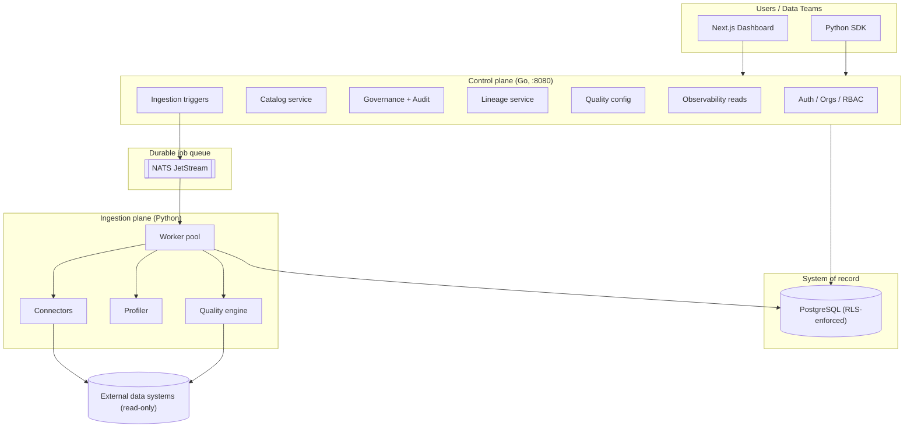

**Control plane** (Go, chi): versioned REST API, Argon2id authentication,
session-cookie sessions, fixed role matrix, catalog search/edit, lineage
ingestion and traversal, quality configuration, governance and audit.
**Ingestion plane** (Python, FastAPI + workers): PostgreSQL/CSV/Parquet
connectors with read-only enforced sessions, bounded-sample profiler,
quality engine with SQLGlot-validated custom SQL, catalog applier with
checksum-based schema versioning. **Data plane**: PostgreSQL with
FORCE ROW LEVEL SECURITY on every organization-scoped table; NATS
JetStream durable jobs with explicit acks.

## Technology stack

| Layer | Technology |
|---|---|
| Frontend | Next.js 16 (App Router), React 19, TypeScript, Tailwind CSS 4, TanStack Query, Recharts |
| Control plane | Go 1.25, chi, pgx, Argon2id, AES-256-GCM |
| Ingestion & processing | Python 3.13, FastAPI, asyncpg, DuckDB, PyArrow, SQLGlot |
| Metadata standards | OpenLineage 2.x runtime events, dbt manifest.json |
| Infrastructure | Docker Compose, PostgreSQL 18, Redis 8, NATS 2.11 (JetStream), SeaweedFS (S3), OpenTelemetry, Prometheus, Grafana |

## Repository structure

```text
DataAtlas/
├── apps/web/                 Next.js dashboard
├── services/
│   ├── control-plane/        Go API, migrations, 13 internal packages
│   ├── ingestion-engine/     Python discovery, profiling, quality, workers
│   └── sdk-python/           Official Python SDK
├── infra/                    PostgreSQL bootstrap, NATS, OTel, Prometheus, Grafana
├── docs/                     architecture, database, api, connectors, security
├── examples/                 sample data, dbt project, OpenLineage fixtures
├── scripts/                  dev automation, demo seeding, screenshot validation
└── .github/workflows/        CI + security scanning
```

## Database model

45+ tables across ten migrations covering tenancy (organizations, users,
memberships, teams), source registry (encrypted credentials, pipelines,
runs, checkpoints), catalog (assets, datasets, dataset_versions,
schema_versions, schema_columns), jobs and lineage (jobs, job_runs,
lineage_edges, column_lineage_edges), profiling (profiling_runs,
profile_snapshots, column_profiles), quality (suites, checks, runs,
results, incidents, freshness_records), governance (glossary, tags,
ownership, classification), and platform services (alerts, notifications,
audit_logs, api_keys, webhooks). See
[docs/database/README.md](docs/database/README.md) for the ER diagram and
[docs/security/threat-model.md](docs/security/threat-model.md) for the
STRIDE analysis.

## Ingestion architecture

1. A source is registered with its **credentials encrypted at rest**
   (AES-256-GCM; ciphertext in PostgreSQL, plaintext never stored or
   returned).
2. Discovery/profiling/quality jobs are published to **durable JetStream
   queues** and consumed by the Python worker pool with explicit acks.
3. Workers load encrypted credentials from PostgreSQL inside
   tenant-bound transactions and decrypt locally — **the broker never
   carries secrets**.
4. The catalog applier records immutable schema versions with content
   checksums, computes change summaries, flags potentially breaking
   changes, and merges column state without overwriting user-authored
   descriptions.
5. Lineage arrives through OpenLineage runtime events, dbt manifest.json,
   or the SDK; every edge carries origin and confidence labels.

## Connector support (implemented and tested)

| Connector | Discovery | Profiling | Quality | Notes |
|---|---|---|---|---|
| PostgreSQL | ✅ schemas/tables/views/columns/PK/FK/row estimates | ✅ | ✅ | Read-only sessions, statement timeouts, scope limiting |
| CSV file | ✅ schema + exact counts | ✅ | ✅ | DuckDB bounded readers |
| Parquet file | ✅ schema + exact counts | ✅ | ✅ | DuckDB metadata reads |
| OpenLineage | ✅ events → jobs, runs, edges | — | — | Idempotent event processing |
| dbt artifacts | ✅ manifest.json → models/sources/edges | — | — | Column docs preserved |

Roadmap connectors (Airflow, Dagster, Snowflake, BigQuery, Spark, Trino,
Kafka, …) are **not** implemented; see
[docs/connectors/README.md](docs/connectors/README.md).

## Screenshots

Every screenshot below is captured from the real running application
against the seeded demo environment. The full manifest lives at
[docs/screenshots/SCREENSHOT_INDEX.md](docs/screenshots/SCREENSHOT_INDEX.md).

### Login

Session-cookie authentication with Argon2id password verification and
organization registration.

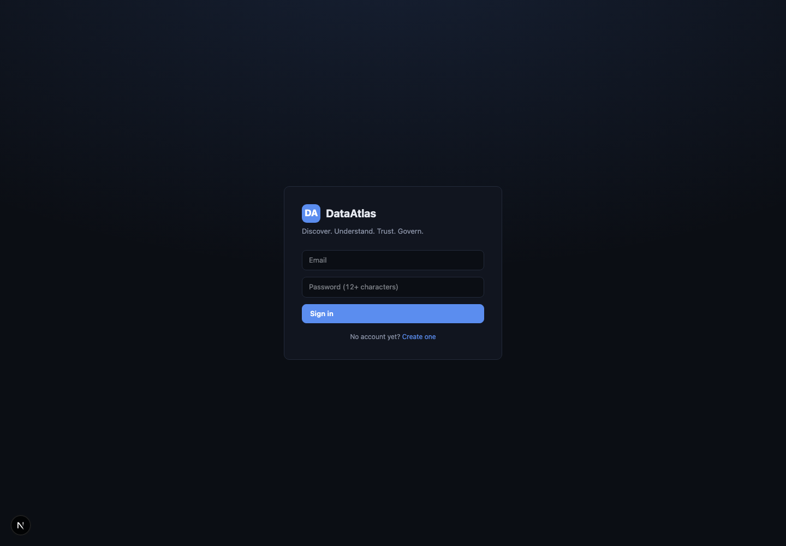

### Main Dashboard

Organization-wide dataset, column and pipeline-run counters with open
alerts, freshness watch and recent pipeline activity.

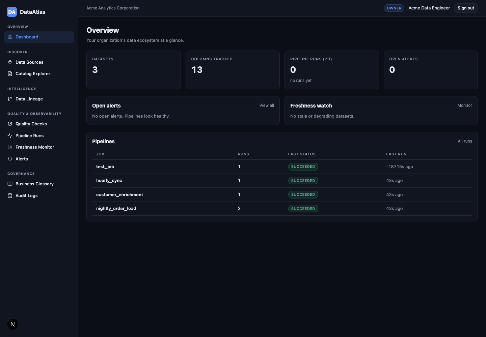

### Source Registry

Registered data sources with encrypted credentials (never displayed
again), lifecycle status, live connection tests and discovery triggers.

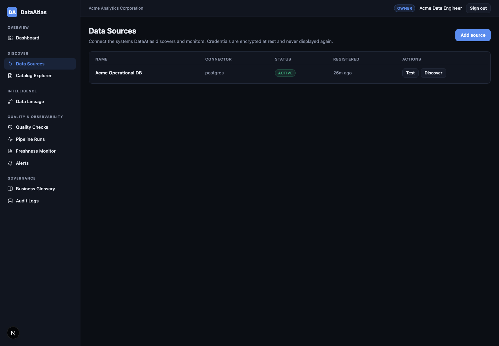

### Add Source

Registration form supporting PostgreSQL, CSV and Parquet connectors;
credentials are submitted exactly once and stored AES-256-GCM encrypted.

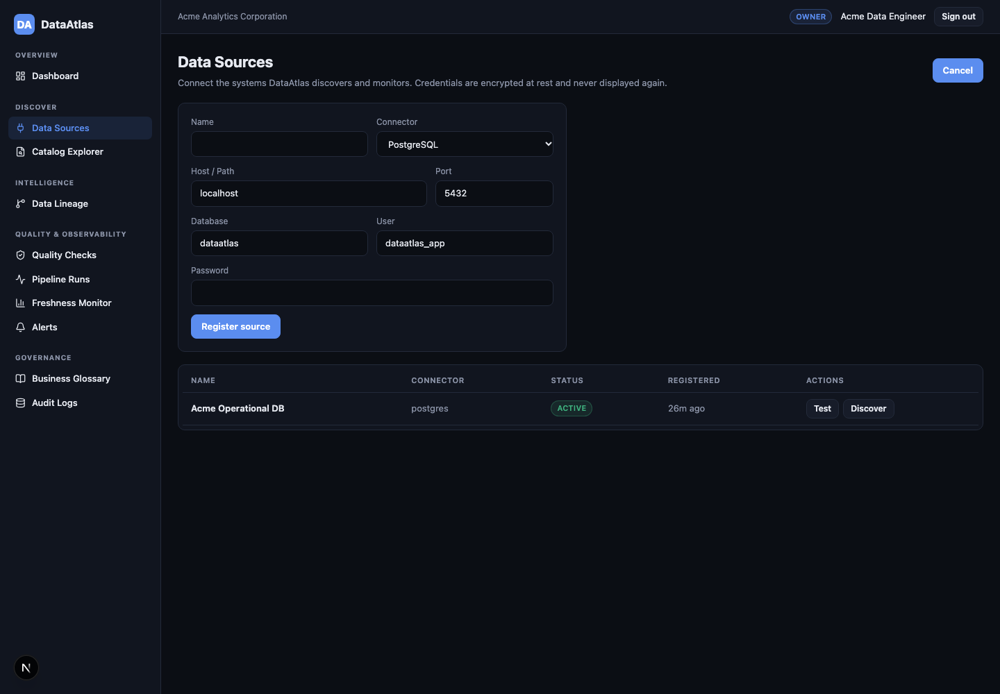

### Catalog Explorer

Server-side search across discovered datasets with type filtering and
pagination.

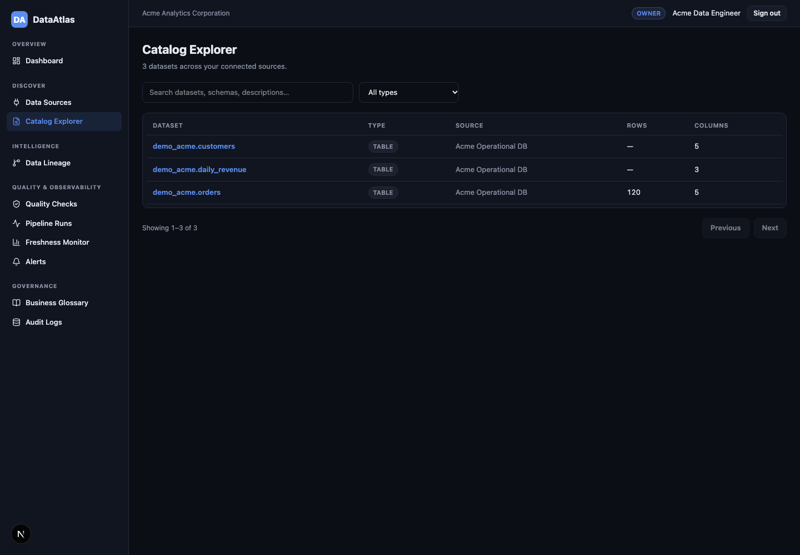

### Dataset Details

Per-dataset overview: row and column counts, current schema version and
ownership, all from discovery evidence.

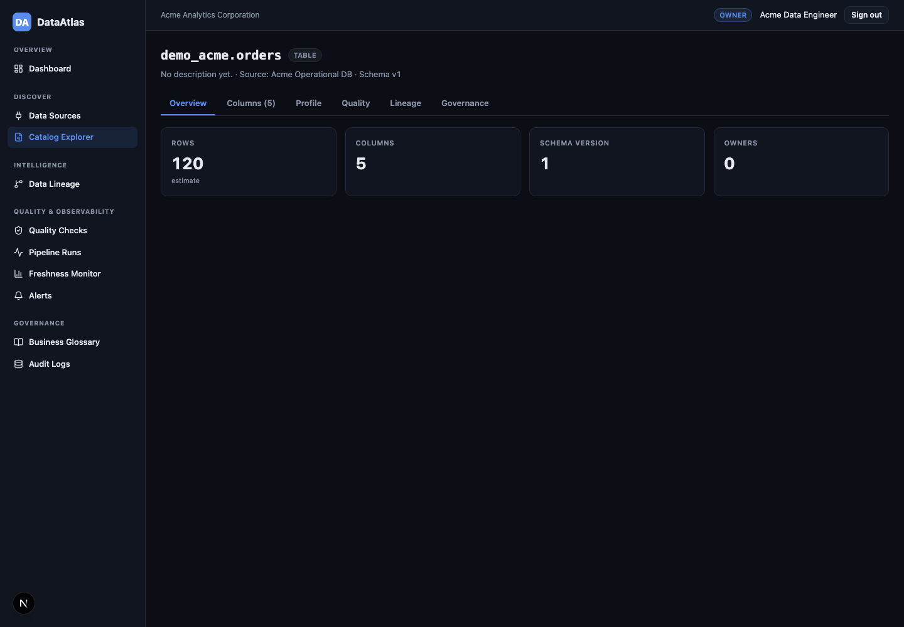

### Column Details

Column-level metadata with data types, nullability and primary/foreign
key evidence.

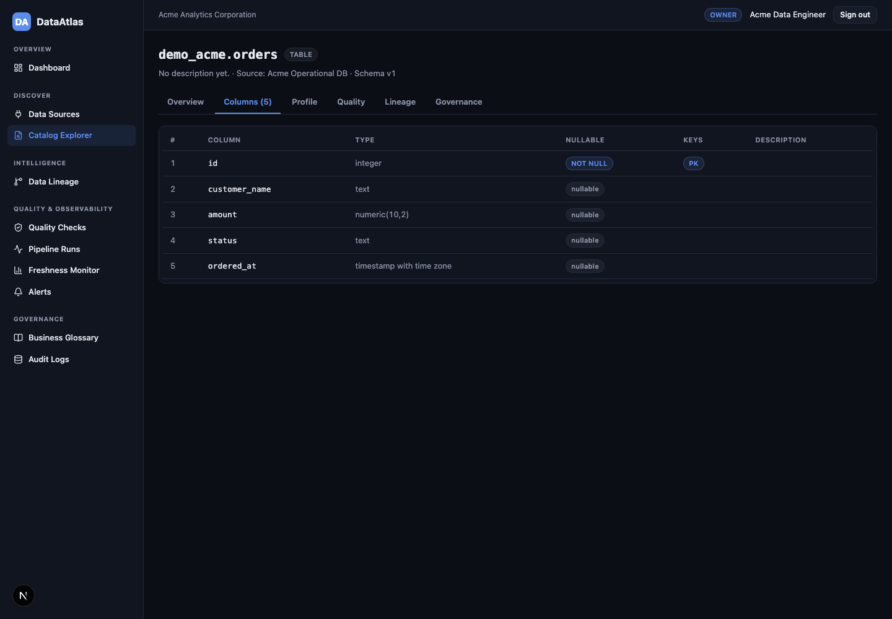

### Dataset Profile

Bounded-sample column statistics — null percentages, distinct counts,
uniqueness, numeric ranges — every metric labeled with how it was
computed (exact / approximate / sample / inferred).

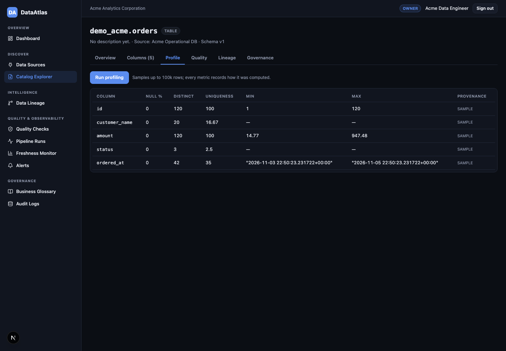

### Data Lineage Explorer

Upstream dependency graphs built from OpenLineage runtime events and dbt
artifacts, laid out by dependency depth with job attribution.

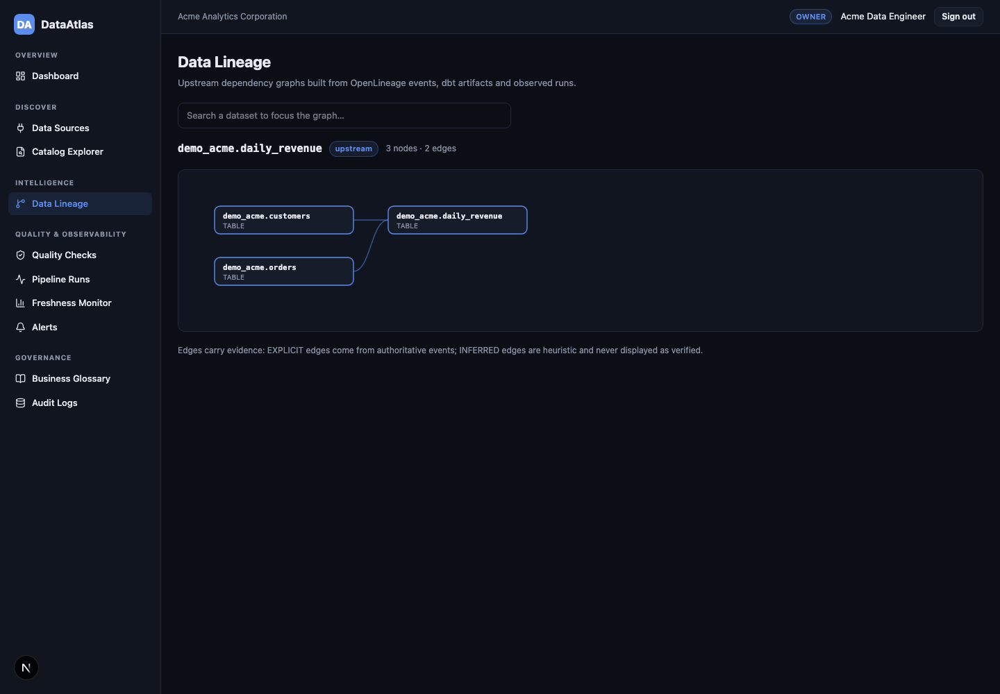

### Quality Checks

Configurable validation across ten check types (not-null, unique,
row-count, accepted values, numeric range, regex, freshness,
referential integrity, schema, custom SQL) executed with read-only,
bounded, parameterized SQL.

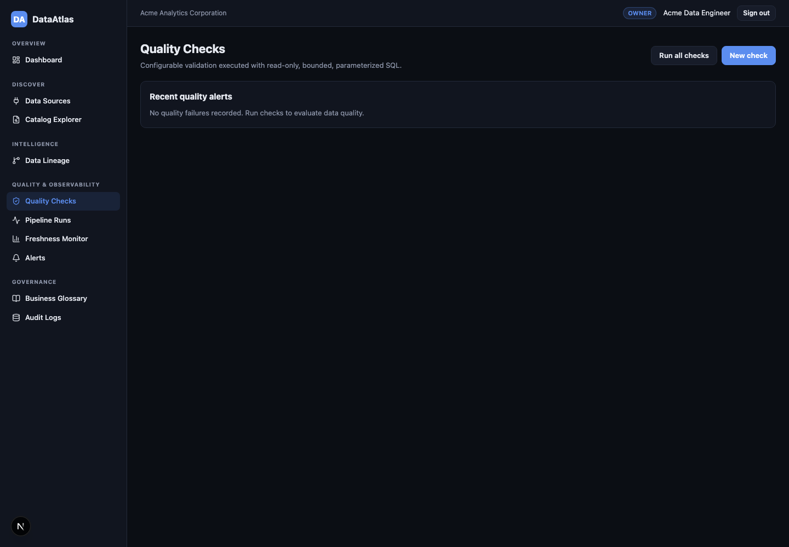

### Pipeline Runs

Job registry with aggregated run statistics, durations and last-seen
status, fed by OpenLineage job runs.

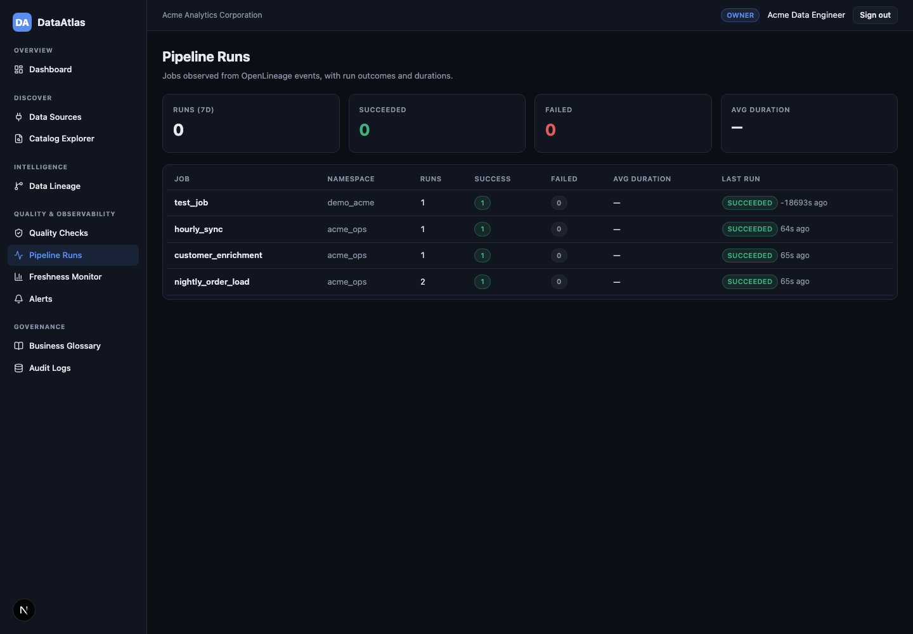

### Freshness Monitor

Expected versus observed freshness per dataset, evaluated from
successful pipeline runs — never from metadata scan times.

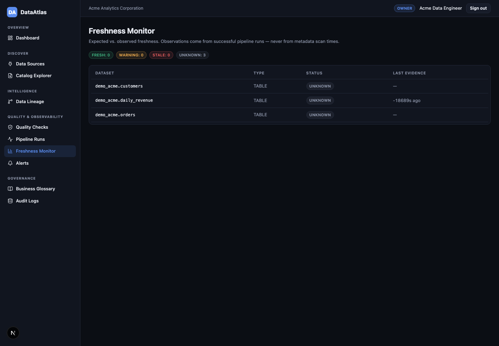

### Alerts

Operational alerts for quality failures and freshness violations, with
acknowledge/resolve lifecycle and per-check deduplication.

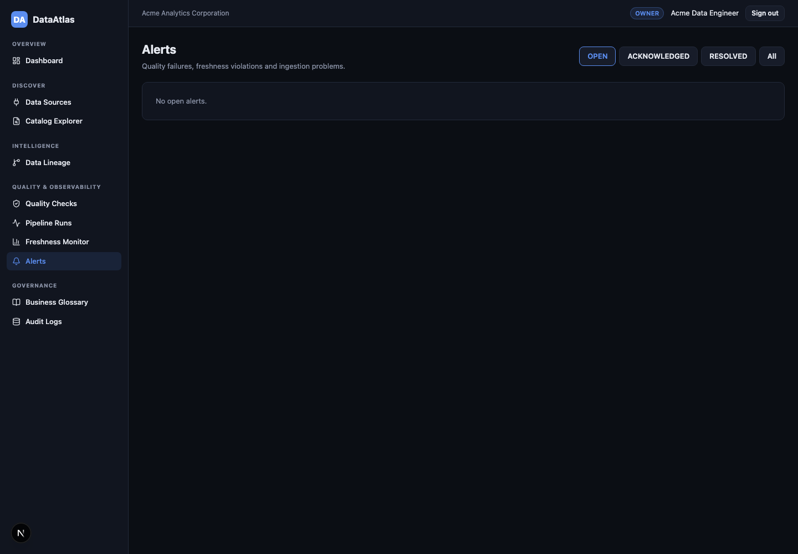

### Business Glossary

Standardized business terminology with definitions, categories and
lifecycle status.

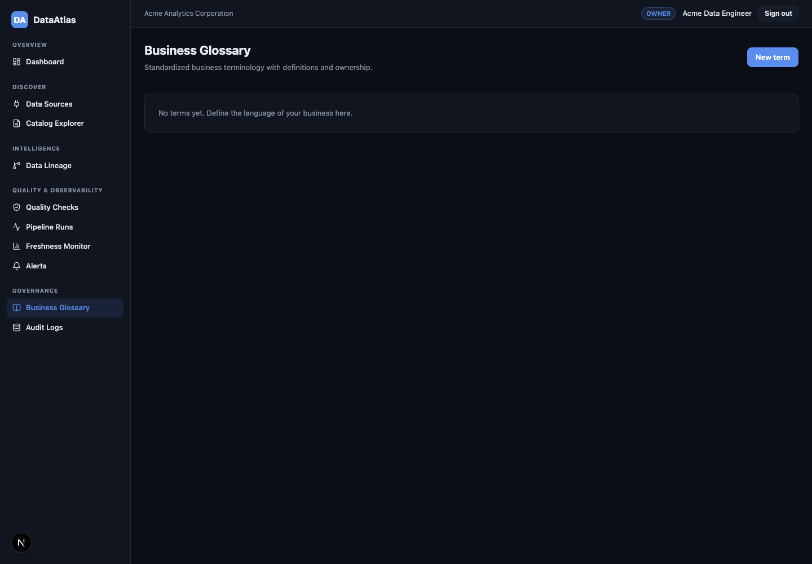

### Audit Logs

Recorded governance and operational actions with actor identity and
timestamps.

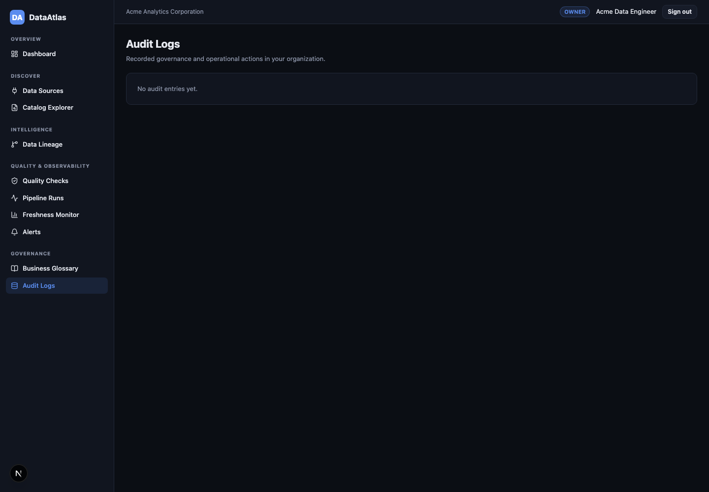

## Getting Started

### Prerequisites

- Node.js ≥ 22, pnpm ≥ 10
- Go ≥ 1.25
- Python ≥ 3.13 with [uv](https://docs.astral.sh/uv/)
- Docker with Compose

### Install and verify

```bash
pnpm install
cd services/ingestion-engine && uv sync && cd ../sdk-python && uv sync && cd ../..

make lint   # gofmt/vet + ruff + mypy + eslint + tsc
make test   # Go unit + Python unit (integration tests auto-skip)
make build  # control plane binary + Next.js production build
```

### Start the full stack

```bash
make infra-up    # PostgreSQL, Redis, NATS, object storage
make migrate     # apply the ten SQL migrations
make dev         # web :3000 + control plane :8080 + ingestion :8090
```

Then open http://localhost:3000 and register an organization, or seed the
demo:

```bash
# One-time demo seed (fictional Acme Analytics Corporation):
export SEED_ADMIN_DB_URL="postgresql://<owner>:<pass>@localhost:5432/dataatlas"
python3 scripts/seed-demo.py
```

Demo login: `demo@acme.test` / `acme-demo-password-123` (local-only).

### Demo workflow

The seed script exercises the complete platform through public APIs: it
creates a fictional business schema, registers it as an encrypted source,
runs connection validation and discovery (catalog + schema versions),
emits OpenLineage events (lineage graph), creates and executes quality
checks (raising alerts on seeded defects), profiles datasets, and records
glossary terms, classifications and freshness expectations.

### Optional observability stack

```bash
make infra-observability   # OTel collector :4317, Prometheus :9090, Grafana :3001
```

## Testing

- **Go**: `go test ./...` (unit) plus `-tags=integration` suites covering
  migrations round-trip, RLS cross-tenant isolation, fail-closed behavior,
  auth lifecycle, source lifecycle, catalog editing, discovery triggering
  and lineage traversal.
- **Python**: `uv run pytest` — connector, crypto interop (Go→Python
  AES-GCM vector), worker end-to-end over real NATS, discovery change
  detection, profiling metrics and the custom-SQL rejection matrix.
- **Frontend**: `pnpm typecheck` + ESLint + production build.

## Security

Security-first design: source credentials are AES-256-GCM encrypted at
rest and never returned by any API; external data systems are accessed
strictly read-only with statement timeouts; every organization-owned row
is protected by enforced Row-Level Security; custom SQL is parsed and
validated before execution. See
[SECURITY.md](SECURITY.md) and
[docs/security/threat-model.md](docs/security/threat-model.md) for the
full STRIDE analysis and residual risks.

## Limitations

- Profiling and quality execute against **sampled data** by default;
  metrics record their provenance and should not be read as exact.
- Column-level lineage exists only where authoritative events establish
  it; SQL parsing is not assumed.
- Rate limiting is per-instance; multi-replica deployments need a shared
  limiter.
- Local stack credentials are for development only.
- Roadmap integrations (Airflow, Snowflake, Spark, …) are not implemented.

## Contributing

See [CONTRIBUTING.md](CONTRIBUTING.md) for setup, standards and pull
request guidelines. All contributions must pass `make lint` and
`make test`.

## License

[MIT](LICENSE)
