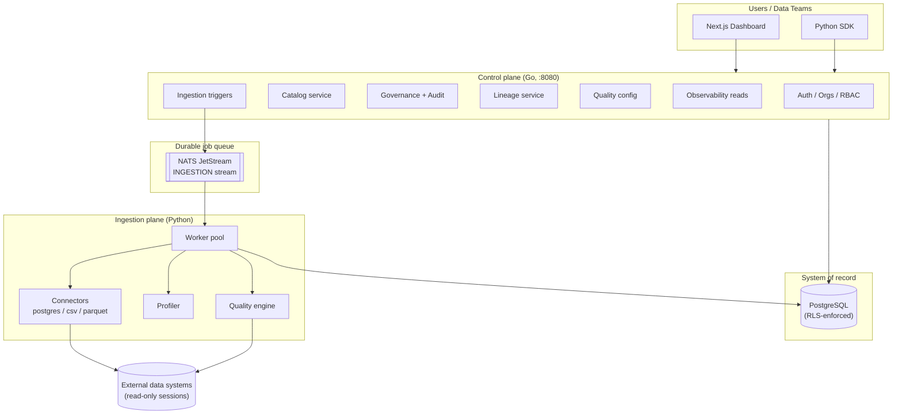

# Architecture

DataAtlas is a modular monolith control plane (Go) with independent Python
workers for metadata ingestion, profiling and quality execution,
communicating through PostgreSQL (system of record) and NATS JetStream
(durable jobs), fronted by a Next.js dashboard.

## The three planes

## Control plane

Stateless Go service (chi) exposing the versioned REST API. Every request
carries an authenticated identity; every organization-owned query runs
inside a transaction whose Row-Level Security GUC
(`app.current_organization_id`) is bound with `set_config(..., true)`.
Authorization uses a fixed role matrix (OWNER → MEMBER) evaluated
server-side per permission.

## Ingestion plane

Python workers consume durable JetStream jobs (`ingestion.discover`,
`ingestion.profile`, `ingestion.quality`) with explicit acks and bounded
redelivery. Workers are the only components that decrypt source
credentials (AES-256-GCM; the control plane encrypts, the database stores
ciphertext, the broker never sees secrets). Discovery writes flow through
the catalog applier, which records immutable schema versions with
checksums and computes change summaries with breaking-change flags.

## Quality and observability plane

Quality checks execute against sources with parameterized, bounded,
read-only SQL; CUSTOM_SQL is SQLGlot-validated (single SELECT). Results
feed quality scores, incidents and alerts (deduplicated per check).
Observability reads aggregate job runs and evaluate freshness from
evidence (successful pipeline runs), never from scan times.

## Key invariants

1. **Tenant isolation is fail-closed**: no tenant GUC → zero rows.
2. **Credentials are encrypted at rest and never returned by any API.**
3. **External systems are read-only**: sessions enforce
   `default_transaction_read_only` plus statement timeouts.
4. **User-authored metadata survives ingestion** (merge policy never
   overwrites descriptions).
5. **Evidence over inference**: lineage edges carry confidence labels;
   freshness uses observed runs, not scan times.
