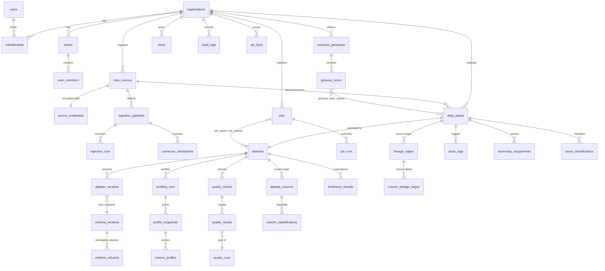

# Database Schema

PostgreSQL is the canonical system of record. 45+ tables across ten
migrations, all organization-scoped and protected by Row-Level Security.

## Core relationships

## Identity and versioning

- **Canonical asset identity**: unique per
  `(organization_id, data_source_id, namespace, name, asset_type)` with a
  generated `full_name` (`namespace.name`) — never mutable display names.
- **Version chain**: `datasets.current_version_id → dataset_versions →
  schema_versions` (immutable snapshots with content checksums).
- **Run records are immutable** once finished; progress payloads are JSONB.

## Row-Level Security

- All organization-scoped tables carry `organization_id` and are
  `FORCE ROW LEVEL SECURITY`.
- Policies compare against `current_setting('app.current_organization_id')`
  (NULLIF-guarded: unset GUC → zero rows).
- `job_inputs`, `job_outputs` and `team_members` derive isolation through
  parent joins.
- The application role `dataatlas_app` is NOSUPERUSER / NOBYPASSRLS so
  policies always apply; see `docs/security/threat-model.md`.

## Migrations

Plain SQL pairs `NNN_name.up.sql` / `.down.sql` under
`services/control-plane/migrations/`, applied transactionally by the
embedded runner (`go run ./cmd/migrate up|down|status`). Migrations are
per-database self-contained — they never perform cluster-wide role
operations in down scripts.
